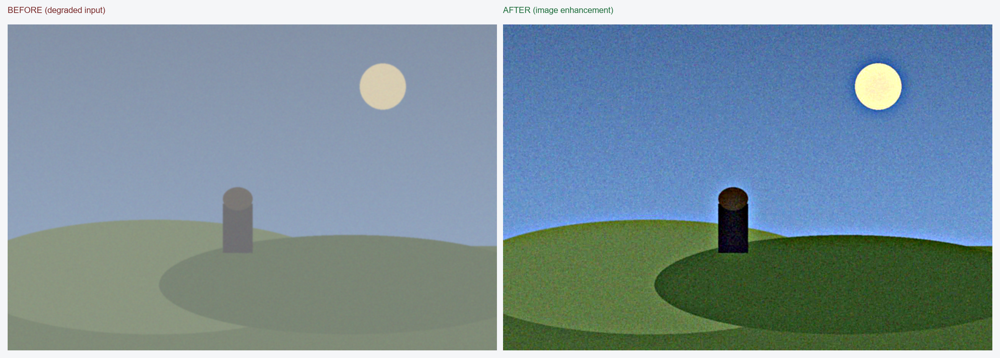
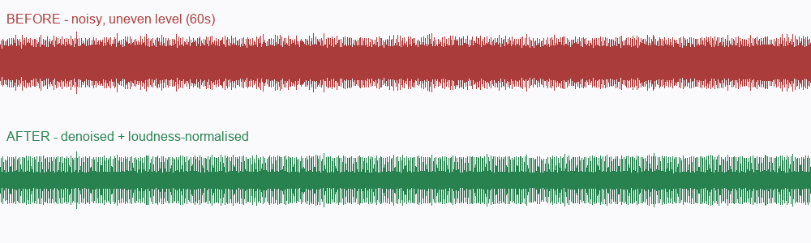
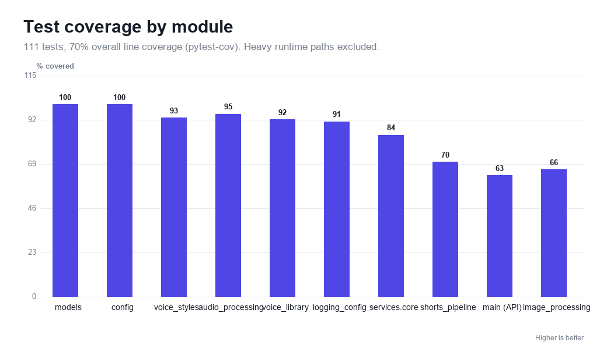

# Xovato AI Studio — CPU Backend

**One backend, nine creator tools, zero GPU required.** Text-to-speech, voice
cloning and design, image enhancement, background removal, face restoration,
audio cleanup, and auto-shorts — all running on a plain CPU box, fully offline,
with nothing uploaded and nothing billed per request.

I built this because the good AI media tools are scattered across a dozen paid
cloud services, each wanting your files and a subscription. Xovato puts them in
one place you own. Drop it on any host that runs Python — no Docker, no CUDA, no
vendor lock-in — and when you outgrow the CPU, the exact same code runs on a GPU
by adding one requirements file.

Everything here is real: the [benchmarks](docs/benchmarks.md) are measured on an
actual CPU, the [samples](docs/samples.md) are produced by the real pipeline, and
what isn't wired up yet is labelled honestly in [feature status](docs/feature-status.md).

## Table Of Contents

| Section | Description |
| --- | --- |
| [Features](#features) | Every product in the studio, what it does, and how to call it. |
| [Demo Samples](#demo-samples) | Real before/after output (images + audio) for each feature. |
| [Folder Map](#folder-map) | What each file/folder is for. |
| [Docs](#docs) | Detailed docs for app, models, environment, and feature status. |
| [API Samples](#api-samples) | One runnable request per feature. |
| [Benchmarks](#benchmarks) | Measured CPU throughput and honest positioning. |
| [Deployment Steps](#deployment-steps) | Recommended deploy order. |
| [Google Colab (GPU)](#google-colab-gpu) | Notebooks that run each model on a GPU. |
| [Securing your models](#securing-your-models) | Optional offline license/key system. |
| [CPU Model Policy](#cpu-model-policy) | Why this package avoids GPU-only assumptions. |
| [Tests](#tests) | Test suite and coverage. |
| [Quick Commands](#quick-commands) | Startup and local check commands. |

> **Requires Python 3.11+** (3.12 recommended). The backend uses `datetime.UTC`
> and `StrEnum`, which are 3.11 features.

## Features

Nine products, one backend. Everything runs on a plain CPU, offline, with no
per-request fee - a GPU only makes it faster (see [docs/gpu.md](./docs/gpu.md)).
Each maps to one endpoint (full samples in [docs/api-samples.md](./docs/api-samples.md))
and to a picker entry in the [Colab Feature Studio](./docs/colab.md).

### 🎙️ Text → Speech
Natural speech from text with 12 built-in stock voices and 8 emotion presets
(neutral, sad, happy, excited, calm, serious, dramatic, intimate). No reference
audio needed. `POST /api/v1/voice/speech`

```bash
curl -X POST $BASE/api/v1/voice/speech -H "Content-Type: application/json" \
  -d '{"text":"Your brand, in a voice you own.","voice_id":"atlas","emotion":"dramatic"}'
```

### 🧬 Voice Cloning
Clone a voice from a short reference clip - **consent-gated** (`consent_verified`
must be true). The reference transcript is used for a measurably better clone.
`POST /api/v1/voice/profiles`

### 🎛️ Voice Design
Build a new voice from attributes - gender, age, accent, pitch - mapped onto the
model's real instruct vocabulary. `POST /api/v1/voice/design`

### 🖼️ Image Enhancement
Analysis-driven: measures exposure, contrast, colour, noise and blur scale from
the image, then applies only the corrections it needs. Returns a full
measurement report in a response header. `POST /api/v1/images/enhance`

### ✂️ Background Removal
True per-pixel alpha via u2netp ONNX, refined against the photo's own edges with
a guided filter (real hair/edge matting, not a hard crop).
`POST /api/v1/images/background-removal`

### 😀 Face Restoration
YuNet detection + GPEN-BFR-256 restoration, each face aligned, rebuilt and
feathered back so only the faces change. `POST /api/v1/images/face-restoration`

### 🔊 Audio Enhancement
Spectral denoise → BS.1770 / EBU R128 loudness normalisation → true-peak limiter.
~5x faster than realtime on CPU. `POST /api/v1/audio/enhance`

### 🎬 Shorts / Vertical Clips
Upload a long video, auto-transcribe (faster-whisper), rank the strongest moments
(heuristic by default, any LLM when a key is set), crop to 9:16 and burn in
captions. `POST /api/v1/shorts/analyze` → `POST /api/v1/shorts/{id}/render`

### 🔌 OpenAI-compatible API
Drop-in `POST /v1/audio/speech` and `POST /v1/audio/transcriptions` for tools
that already speak the OpenAI audio API.

| Product | Endpoint | Engine | Status |
| --- | --- | --- | --- |
| Text → Speech | `/api/v1/voice/speech` | OmniVoice (CPU/GPU) | ✅ preview on CPU, real model optional |
| Voice Cloning | `/api/v1/voice/profiles` | OmniVoice clone prompt | ✅ consent-gated |
| Voice Design | `/api/v1/voice/design` | instruct attributes | ✅ |
| Image Enhancement | `/api/v1/images/enhance` | Pillow/NumPy | ✅ |
| Background Removal | `/api/v1/images/background-removal` | u2netp ONNX | ✅ needs model file |
| Face Restoration | `/api/v1/images/face-restoration` | YuNet + GPEN-BFR-256 | ✅ needs model files |
| Audio Enhancement | `/api/v1/audio/enhance` | BS.1770 DSP | ✅ |
| Shorts | `/api/v1/shorts/*` | Whisper + ffmpeg | ✅ |
| OpenAI API | `/v1/audio/*` | routes to the above | ✅ |

> `$BASE=http://localhost:8000`. See [Feature Status](./docs/feature-status.md)
> for the exact connected/preview state of each.

## Folder Map

| Path | Why we need it |
| --- | --- |
| `app/` | FastAPI backend code prepared for deployment. |
| `app/model_manager.py` | Lists CPU model paths and reports whether model files exist. |
| `app/services/` | Service facade folder matching the clean deployment structure. |
| `app/utils/` | Small file/cleanup helpers for deployment work. |
| `models/` | CPU-only model root for segmentation, face, optional OmniVoice, Whisper CPU, and audio CPU assets. |
| `docs/` | Detailed explanation files for each deployment area. |
| `tests/` | Deployment package tests. |
| `Xovato_AI_Studio_Colab.ipynb` | Google Colab notebook that runs every model feature on a GPU. |
| `requirements.txt` | Python dependencies for the deployed backend. |
| `frontend.env.example` | Frontend environment variable template. |
| `backend.env.example` | Backend environment variable template with CPU-safe defaults. |
| `start-backend.txt` | Backend start command for hosts that ask for it separately. |

## Deployment Steps

| Step | Action | Why |
| --- | --- | --- |
| 1 | Configure backend env from `backend.env.example`. | Gives FastAPI CPU runtime and optional Supabase output settings. |
| 2 | Copy CPU model files with `models/copy-models.ps1` if needed. | Adds optional local models for CPU inference. |
| 3 | Run deployment tests. | Confirms the package has the expected files and CPU defaults. |
| 4 | Deploy this `deployment` folder as the backend API. | Runs the FastAPI API. |
| 5 | Deploy `../xovato-app` as the frontend. | Runs the user-facing Next.js app. |
| 6 | Configure frontend env from `frontend.env.example`. | Lets the Next.js app reach backend and optional Supabase. |

## Docs

| Doc | What it explains |
| --- | --- |
| [Docs Index](./docs/README.md) | All deployment docs in one place. |
| [App Package](./docs/app-package.md) | Why `app/` exists and how the backend is packaged. |
| [Models](./docs/models.md) | CPU model folders and why each model is needed. |
| [Environment](./docs/environment.md) | Frontend/backend env variables and secrets. |
| [Feature Status](./docs/feature-status.md) | Which features are connected, partial, or preview-only. |
| [API Samples](./docs/api-samples.md) | A curl sample for every feature endpoint. |
| [Samples](./docs/samples.md) | Real before/after demo output for each feature. |
| [Benchmarks](./docs/benchmarks.md) | Measured CPU numbers and a comparison to hosted services. |
| [GPU](./docs/gpu.md) | Optional NVIDIA GPU acceleration. |
| [Colab](./docs/colab.md) | Running every feature on a Colab GPU from one notebook. |
| [Per-model Colab](./colab/README.md) | One notebook per model: test, benchmark, accuracy, training notes. |
| [Licensing](./docs/licensing.md) | Optional offline key-based model licensing. |
| [Contributing](./docs/CONTRIBUTING.md) | Setup, tests, conventions. |
| [Changelog](./docs/CHANGELOG.md) | What changed, grouped by theme. |

## Demo Samples

Real output from the actual backend (see [docs/samples.md](./docs/samples.md) for
all of them and how to regenerate). Inputs are synthetic so they are reproducible
and license-free.

**Image enhancement** - contrast, colour and detail recovered from a flat,
noisy, soft input:



**Background removal** - true per-pixel alpha from u2netp (shown on a checkerboard):


**Audio enhancement** - a full 1-minute clip: denoised and loudness-normalised
([before](./docs/assets/samples/audio_before.wav) / [after](./docs/assets/samples/audio_after.wav) WAV):



## API Samples

The full endpoint list is in [Features](#features) above; every runnable request
(curl, uploads, polling) is in [docs/api-samples.md](./docs/api-samples.md).

Example - enhance an image and read its measurement report:

```bash
curl -s -X POST http://localhost:8000/api/v1/images/enhance \
  -F "image=@photo.jpg" -F "output_format=jpg" -o enhanced.jpg
```

Text to speech with a stock voice:

```bash
curl -s -X POST http://localhost:8000/api/v1/voice/speech \
  -H "Content-Type: application/json" \
  -d '{"text":"Hello from Xovato.","voice_id":"aria","emotion":"calm"}'
```

## Benchmarks

Measured on a 2017-class Intel CPU, single process, CPU only. Full method and a
capability comparison to ElevenLabs / Adobe / remove.bg are in
[docs/benchmarks.md](./docs/benchmarks.md).


| Feature | Input | CPU time |
| --- | --- | --- |
| Image enhancement | 3 MP photo | ~1.6 s |
| Image enhancement | 8 MP photo | ~3.9 s |
| Audio enhancement | 60 s stereo | ~12 s (≈5x realtime) |
| Audio enhancement | 5 min stereo | ~66 s |

Xovato is local, open-source and CPU-first: no per-request fee, nothing uploaded,
runs offline. Hosted GPU services are usually faster on their one flagship
feature - the trade is cost, privacy and lock-in. See the
[full comparison](./docs/benchmarks.md#positioning-vs-popular-services).

## Google Colab (GPU)

`Xovato_AI_Studio_Colab.ipynb` runs the same `app/` code on a Colab GPU, with a dropdown that
switches between text to speech, voice cloning, transcription, image enhancement, background
removal, face restoration, audio enhancement, and shorts rendering.

| Step | Action |
| --- | --- |
| 1 | Open the notebook in Colab and set `Runtime` -> `Change runtime type` -> `T4 GPU`. |
| 2 | Run cells 1 to 5 in order. They install dependencies, download models, and patch the device layer. |
| 3 | Pick a feature in the Feature Studio and press Run. |

No file in `app/` is changed by the notebook. See [docs/colab.md](./docs/colab.md) for what each
patch replaces and why.

For a **per-model deep dive** - download, inference test, latency benchmark,
accuracy signal and training/fine-tuning notes for each model individually - see
the [colab/](./colab/README.md) folder (one notebook per model).

## Securing your models

If you distribute a build and want only authorised machines to run it, Xovato
includes an optional **offline license system** (Ed25519 keys, no phone-home):

- create a **root** keypair (your trust anchor),
- optionally delegate to **admins** who can issue licenses without your root key,
- issue licenses **bound to a machine** with a feature list and expiry,
- verify fully offline against the root public key.

```bash
pip install -r requirements-security.txt
python -m scripts.licensing.license_tool keygen --role root --out keys
python -m scripts.licensing.license_tool issue --signer-key keys/root_private.pem \
  --subject "ACME" --machine $(python -m scripts.licensing.license_tool fingerprint) \
  --features tts,image,shorts --days 365 --out license.json
python -m scripts.licensing.license_tool verify --license license.json --root-pub keys/root_public.pem
```

Private keys are gitignored; a [CI workflow](./.github/workflows/license-check.yml)
runs the licensing tests and verifies any committed license. Full guide:
[docs/licensing.md](./docs/licensing.md).

## CPU Model Policy

This deployment folder is intentionally CPU-only:

- no CUDA requirement
- no GPU Docker image
- no RealESRGAN/GFPGAN GPU `.pth` deployment requirement
- real OmniVoice is optional and disabled by default with `ENHANCEAI_USE_REAL_OMNIVOICE=false`
- background removal and face restoration use CPU ONNX paths when model files are present

Moving to an NVIDIA GPU later is opt-in and does not change the CPU deploy: install
[`requirements-gpu.txt`](./requirements-gpu.txt) and follow [docs/gpu.md](./docs/gpu.md).
GPU wheels (`torch`, `onnxruntime-gpu`, `pycuda`, `cuda-python`) are fetched from
their package indexes by pip, not vendored into the repo.

## Tests

Install the dev dependencies and run the suite (111 tests, ~70% line coverage):

```bash
pip install -r requirements-dev.txt
pytest
```

Coverage is configured in `pytest.ini`; an HTML report is written to
`htmlcov/index.html`. The heavy runtime paths (torch/OmniVoice, ffmpeg, ONNX
models, Supabase network) are exercised through their guard paths but not with
the real runtimes, which is why overall coverage sits at 70% rather than higher.



## Quick Commands

Install backend dependencies on your host:

```bash
pip install -r requirements.txt
```

Copy CPU-compatible models:

```powershell
.\models\copy-models.ps1
```

Run backend from this deployment folder:

```bash
uvicorn app.main:app --host 0.0.0.0 --port $PORT
```

