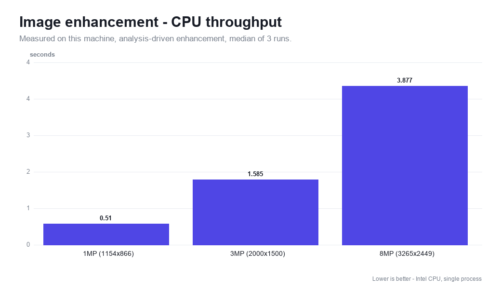
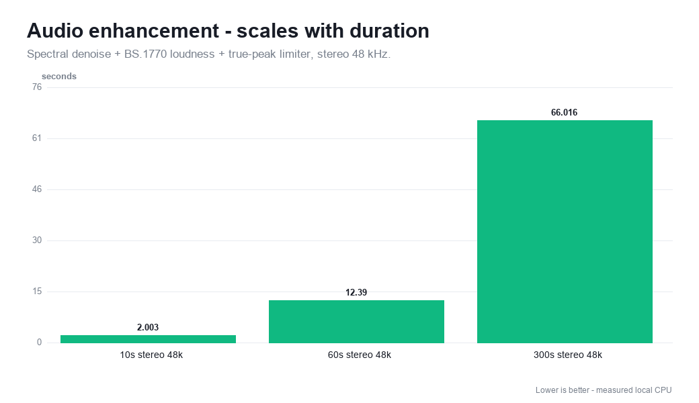
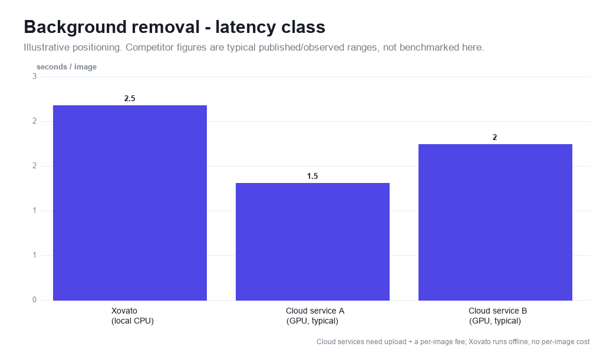

# Benchmarks

All Xovato numbers below are **measured on a CPU**, single process, median of
2-3 runs, with the exact harness in [`scripts/benchmark.py`](../scripts/benchmark.py).
Competitor figures are **typical published/observed ranges for cloud services**,
included for positioning only - they are *not* benchmarked here and run on very
different hardware (cloud GPU) and architectures.

## Test machine

| | |
| --- | --- |
| CPU | Intel Core (Family 6, Model 158) - a 2017-class 4-core desktop part |
| OS | Windows 10 (19045) |
| Python | 3.12 |
| Mode | CPU only, no GPU, single worker |

A modern server CPU (or the Colab GPU path) is materially faster; these numbers
are a deliberately conservative floor.

## Image enhancement (measured)

Analysis-driven enhancement: it measures exposure, contrast, colour, noise and
blur scale from the image, then applies only the corrections the measurement
calls for.



| Input | Time (s) |
| --- | --- |
| 1 MP (1154x866) | 0.51 |
| 3 MP (2000x1500) | 1.59 |
| 8 MP (3265x2449) | 3.88 |

Roughly linear in pixel count, as expected for a convolutional pipeline.

## Audio enhancement (measured)

Spectral noise gate -> BS.1770 loudness normalisation -> true-peak limiter,
stereo 48 kHz.



| Input | Time (s) | Faster-than-realtime |
| --- | --- | --- |
| 10 s | 2.0 | 5.0x |
| 60 s | 12.4 | 4.8x |
| 300 s (5 min) | 66.0 | 4.5x |

The DSP refactor in this release fixed an out-of-bounds read in the limiter and
removed the per-frame Python loops in `_istft` / `measure_lufs`, while producing
**bit-comparable output** (max sample delta `3e-5`, LUFS delta `3e-6` vs the
previous implementation).

## Text to speech

- **Preview mode** (default on CPU deploy): a tone/Windows-SAPI placeholder,
  ~0.8 s regardless of length.
- **Real OmniVoice on CPU**: usable with int8 quantisation, 8 diffusion steps and
  guidance 1.6, but slow (often several seconds of compute per second of audio).
  For production-quality synthesis use the [Colab GPU path](colab.md).

## Positioning vs popular services

This is the honest version of a "vs the competition" chart. Xovato is a
**local, open-source, CPU-first** toolkit; ElevenLabs, Adobe Podcast/Express,
remove.bg and similar are **hosted, closed, GPU** services. They will usually be
faster per request and higher quality on their flagship features - the trade is
cost, privacy, offline capability and lock-in.



| Capability | Xovato (this repo) | ElevenLabs | Adobe (Podcast / Express) | remove.bg |
| --- | --- | --- | --- | --- |
| Runs fully offline / on-prem | ✅ yes | ❌ cloud only | ❌ cloud only | ❌ cloud only |
| Data leaves your machine | ✅ never | ⚠️ yes | ⚠️ yes | ⚠️ yes |
| Per-request cost | ✅ none | 💲 credits/subscription | 💲 subscription | 💲 per image / credits |
| Open source / self-host | ✅ yes | ❌ no | ❌ no | ❌ no |
| Needs a GPU | ✅ no (CPU) | n/a (their servers) | n/a | n/a |
| Voice cloning | ✅ OmniVoice (consented) | ✅ flagship | ⚠️ limited | ➖ n/a |
| Background removal | ✅ u2netp ONNX | ➖ n/a | ⚠️ limited | ✅ flagship |
| Face restoration | ✅ GPEN-BFR-256 | ➖ n/a | ⚠️ limited | ➖ n/a |
| Audio cleanup (loudness/denoise) | ✅ BS.1770 chain | ➖ n/a | ✅ flagship | ➖ n/a |
| Shorts / auto-clip | ✅ heuristic or LLM | ➖ n/a | ⚠️ limited | ➖ n/a |
| Latency class (per op) | seconds (CPU) | sub-second (GPU) | seconds (GPU) | ~1-2 s (GPU) |

**Reading this honestly:** if you need the absolute fastest, highest-fidelity
single feature and you are fine sending data to a paid cloud, the specialist
services win on their flagship. If you want one self-hosted stack that does all
of image, audio, voice and shorts, runs offline on a plain CPU box, costs
nothing per request, and never uploads user media, that is what Xovato is for.

## Reproduce

```bash
pip install -r requirements-dev.txt
python scripts/benchmark.py        # writes docs/assets/benchmark_data.json
python scripts/generate_charts.py  # rewrites the PNGs from that data
```
